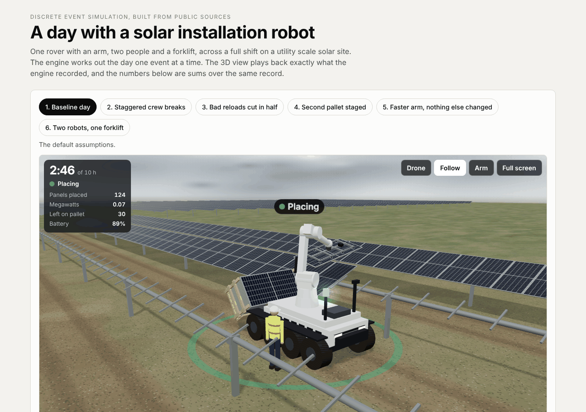

# Solar install robot day

A discrete event simulation of one shift of a robot assisted solar installation crew, shown in 3D. Built from public sources.

Live page: https://coffinlindsey-hub.github.io/solar-install-robot-day/



## What it is

A single web page that simulates one day on a utility scale solar site: a wheeled rover with an industrial arm picks panels from the pallet it carries and sets them on the racking, one person walks with it and moves it forward, a second person checks and fastens each panel, and a forklift brings fresh pallets.

The day plays out in a 3D scene. You can turn and zoom the view, switch between a drone view, a view that follows the robot and a close view of the arm, move through time, and run the day at anything from real time to a whole shift in a minute. Rows fill with panels as the day goes on.

It is a learning tool for questions about where a robot's day goes and what limits panels installed per day. It is not a model of any real site, machine or company.

## How the model works

- The engine keeps a list of future events (a panel is set down, a forklift arrives, a break ends) and jumps from one to the next. It writes down what every robot and forklift was doing between events.
- That record is the only output. The numbers on the page are sums over it, and the 3D view plays the same record back, so the picture and the numbers cannot disagree.
- The cycle: pick and place a panel, the crew fastens it, move forward after every second panel, repeat down the row, then drive round the row end into the next row.
- The robot may only get a few loose panels ahead of the person fastening. Past that it waits.
- A pallet holds a fixed number of panels. The forklift is called when a few are left. A reload is short when it goes well and long when it does not, with a set share going badly.
- The robot stops when its crew stops, unless breaks are staggered. Then one person covers both jobs at a slower pace.
- Other stops: vision or placement faults, racking out of tolerance, damaged panels, weather holds, a second try at a stop, and a trip to the charger if the battery cannot last the shift.
- Travel times come from the site layout: row length, distance between rows, and the distances to the pallet staging area and the charging depot.
- Times are drawn from distributions, mostly triangular (fastest, typical, slowest). Rare events have a chance per panel or per day.
- Each scenario runs for 30 days with different random seeds. Results are shown as an average with the lowest and highest day. Scenarios share seeds, so each one faces the same luck.
- The page shows a hand calculation of the most panels possible if nothing ever stopped, next to the simulated result, and splits the gap by where the time went.
- It also reports robot running hours (hours spent placing panels) apart from shift hours, availability, performance and quality (the three parts of overall equipment effectiveness), and a comparison with a manual crew of the same size.

## Scenarios included

1. Baseline day
2. Staggered crew breaks, so the robot never stops for lunch
3. Bad reloads cut in half
4. A second pallet staged beside the robot, so a reload becomes a swap
5. A faster arm with nothing else changed, to test whether cycle time is the constraint
6. Two robots sharing one forklift

Any scenario can be saved as A and compared side by side with another run as B. Every parameter can be changed on the page.

## Assumptions and sources

Every number is either a cited public figure or a labeled assumption. Nothing comes from any company's internal data. The page lists every parameter with its default, unit and tag, and all assumptions in one place.

### Taken from public sources

- Panel: 2278 x 1134 x 30 mm, about 32 kg, 580 W.
- 31 panels per pallet.
- 84 panels per tracker row in portrait, rows 6 m apart, torque tube 1.5 m above ground.
- Manual install rate: 12 panels per person hour worked. Published figures run from about 3 to about 13, and the page shows that range.

### Assumptions, with their defaults

- Shift: 10 hours, a 30 minute lunch, two 15 minute breaks, 15 minutes of briefing and checks at the start, 10 minutes of wrap up.
- Pick and place: 30 to 40 seconds a panel, typically 35. Two panels per stop, then about 8 seconds to move forward. 3 percent of stops need a second try.
- Fastening: 34 to 56 seconds a panel, typically 44, by one person, which is slower than the robot. The robot may be 3 panels ahead and then waits. 2 percent of panels need reseating.
- Reloads: about 2 minutes when good, 10 to 20 minutes when bad, 15 percent bad. Forklift called with 6 panels left, about 1.5 minutes to pick up a pallet, 2.5 m/s on site.
- Faults per panel: 1.5 percent vision or placement, 1 percent racking out of tolerance, 0.3 percent damaged panel. Each costs a few minutes.
- Weather: a hold on about one day in four, typically 30 minutes.
- Battery: 60 kWh, drawing 3.5 kW placing, 6 kW driving and 0.8 kW stopped. Goes to a 20 kW charger at 10 percent.
- Site: staging area 120 m and charging depot 200 m from the block. Driving at 1 m/s, because a person walks with the robot.
- Breaks and holds start when the task in hand is finished.

### Sources

- [Suntech, 580 to 600 W bifacial module datasheet](https://suntech-power.com/wp-content/uploads/download/product-specification/STP580-600S-C72-Nsh+.pdf). 144 half cells, 2278 x 1134 x 30 mm, 32.0 kg.
- [Lesso, 560 to 580 W bifacial module datasheet](https://www.lessosolar.com/uploads/580W-182-N-topcon-Bifacial-Module.pdf). 31 pieces per pallet with a 35 mm frame, 36 with a 30 mm frame.
- [Single axis tracker datasheet (public planning exhibit)](https://townofmarlboroughny.gov/DocumentCenter/View/3387/Independent-Solar-Exhibit-N). Typical row 78 to 90 modules; rotation axis 1.3 to 1.8 m above ground; ground cover ratio typically 28 to 50 percent.
- [Single axis tracker datasheet, one module in portrait (public zoning file)](https://kanecountyil.gov/FDER/Zoning%20Petitions%20Documents/Array%20Datasheet_DuraTrack_September%202022.pdf). Typical 84 to 112 modules per row; torque tube 54 inches above grade as standard.
- [Engineering News Record, contractor field trial of installation robots](https://www.enr.com/articles/60249-rosendin-electric-deploys-custom-robots-to-install-solar-panels). Under a minute per panel; about 600 panels in a 10 hour shift with a two person crew; a traditional crew in similar conditions averaged 100 to 120 panels per 10 hour shift.
- [pv magazine USA, robots working beside a crew (2025)](https://pv-magazine-usa.com/2025/04/08/robots-to-work-side-by-side-with-humans-to-demonstrate-solar-module-installation/). 350 to 400 modules per 8 hour shift with a two person crew, described as three times a standard three to four person manual crew.
- [TaiyangNews, summary of a vendor white paper on robotic module mounting](https://taiyangnews.info/technology/evaluating-robotic-module-mounting-for-utility-scale-pv-projects). Claimed average 600 modules per day and about 25 minutes per pallet of 36 including loading; battery runtime up to 10 hours; one project averaged a little over 400 per day across 22 working days; manual crews put at 200 to 300 modules per day.
- [Robotics 24/7, 100 MW installed by a robot fleet (2026)](https://www.robotics247.com/article/maximo-completes-100-megawatt-robotic-solar-installation). More than one module per minute; up to 24 modules per shift hour per person, described as nearly double traditional methods.
- [Maxeon, module safety and installation manual](https://maxeon.com/sites/default/files/2024-09/Safety_Installation_Manual_UL_Certified_product_544753_Rev_H.pdf). Do not install or handle modules when they are wet or during periods of high wind. No wind speed is given.

## What it does not model

- Fastening as anything more than one person and a time per panel. No torque checks, clips or wiring.
- Terrain. The site is flat, and the rover never gets stuck.
- Traffic. Robots, forklifts and people never block each other in an aisle.
- Pallet supply. The staging area never runs out.
- Learning. The crew is as fast in the first hour as in the last.
- Weather as a forecast. Holds arrive at random.
- Breaks and holds starting in the middle of a task.
- Cost, safety incidents, and commissioning the robot on a new site.
- Real equipment. The shapes in the 3D view are generic stand ins built from simple shapes.

## Run it

Open `index.html` in a browser. There is no build step and nothing to install.

Tests for the engine use only what ships with Node:

```
node --test tests/sim.test.js
```

## Files

- `sim.js`: the simulation engine, the hand calculation and the manual crew calculation.
- `params.js`: every parameter with its default, unit, tag and source, plus the scenarios.
- `scene3d.js`: the 3D view. It only draws what the engine recorded.
- `app.js`, `index.html`, `style.css`: the page.
- `tests/sim.test.js`: tests, for example that every second of the shift is accounted for, that no panel is lost or invented, and that the simulation never beats the hand calculation.
- `vendor/three.min.js`: three.js r159, the only library, used for 3D drawing. MIT license, included in `vendor/`.
